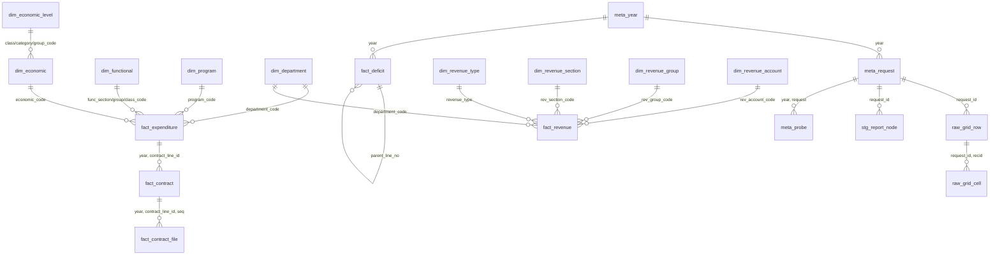

# DuckDB database

**English** | [Հայերեն](../hy/database.md) | [Русский](../ru/database.md)

File: `data/arm_budget.duckdb` (built with `make build`; recreated from scratch from `data/raw` and `data/catalog` on
every run). The full list of columns is in [data_dictionary.md](../data_dictionary.md) (generated from the
`COMMENT ON` descriptions, which are also stored in the database itself).

## Design principles

1. **Layers.** Provenance (`meta_*`) → classifiers (`dim_*`) → facts (`fact_*`) → every row of every report tree
   (`stg_report_node`) → lossless grid cells (`raw_*`) → data quality checks (`qc_*`) → views (`v_*`).
2. **Finest grain.** Facts are the leaves of the most detailed query the site allows: for expenditures
   functional class × program × department × economic article (≈3 600 lines a year), for revenues revenue type ×
   section × group × department × account (≈450–480 lines a year, plus one `unallocated` row per year and type with
   the part of the plan that the site does not distribute to the accounts). All totals of the site can be reproduced
   by summing them; subtotals published by the site are in `stg_report_node` and are checked (`qc_tree_subtotal`).
3. **Codes, not names, in the facts.** Facts carry classifier codes (strings, with leading zeros: `'01'`,
   `'010101'`, `'004828'`, `'4111'`, `'900005160750'`). Names are in the `dim_*` tables in three languages:
   `name_hy` (source), `name_en`, `name_ru` (translations, see [translations.md](translations.md)). A code keeps the
   name of the latest year it appears in; all yearly names are in `dim_name`.
4. **Wide by period.** One fact row has the 8 amounts of the source: plan and executed for Q1, H1, 9 months and the
   year (`q1_plan_kamd` … `year_actual_kamd`), cumulative from 1 January, in **thousand AMD** (`_kamd`), exact
   `DECIMAL` values as published. `v_*_long` views have one row per period.
5. **Lossless.** Every cell of every report grid is in `raw_grid_cell` (strings as in the source, incl. the `%`
   columns); facts point to their source row (`request_id`, `recid`).
6. **Reproducible.** Schema — `sql/schema.sql`, views — `sql/views.sql`, checks — `sql/qc.sql`; the build is atomic
   and needs no network (code resolution uses the stored probes).

## Schema



## Tables

### Metadata

| table | one row = | key |
|---|---|---|
| `meta_language` | language of the names (hy source, en, ru) | `lang` |
| `meta_report` | report of the site (expenditure, revenue, deficit) | `report` |
| `meta_year` | budget year on the site, its `SITE_YEAR` index and "as of" date | `year` |
| `meta_site_total` | total of a report in the menu of the start page (latest year) | `report` |
| `meta_request` | report query and the file with its result | `request_id` = `<name>@<year>` |
| `meta_probe` | filtered query used to resolve classifier codes | `year, request, dim, code` |
| `meta_document` | PDF document linked from a form | `file` |
| `meta_label` | caption / option of the site interface with translations | `context, key` |

### Classifiers

| table | one row = | key | levels / notes |
|---|---|---|---|
| `dim_functional` | functional classification (COFOG) | `code` | `level` 1 section (2 digits), 2 group (4), 3 class (6); `parent_code` |
| `dim_program` | program/measure | `code` (6 digits) | |
| `dim_department` | state body (administrative classification) | `code` (6 digits) | shared by expenditures and revenues |
| `dim_economic` | economic article of expenditures | `code` (4 digits) | `class_code`, `category_code`, `group_code` → `dim_economic_level` |
| `dim_economic_level` | class / category / group of the economic classification | `code` (1–3 digits) | from the PDF guidelines |
| `dim_revenue_type` | revenue type (`SITE_EBUDG`) | `revenue_type` | 0 all, 1 taxes and duties, 2 grants, 3 other |
| `dim_revenue_section` | revenue section | `code` (2 digits) | |
| `dim_revenue_group` | revenue group | `code` (4 digits) | does not start with the section code |
| `dim_revenue_account` | treasury revenue account | `code` (12 digits) | |
| `dim_period` | period of the value columns | `period` | q1, h1, m9, year |
| `dim_name` | name of a code in a year | `report, dim, code, year` | names change between years |
| `dim_translation` | translation dictionary hy → en / ru | `context, hy` | `data/translations/*.csv` |

Every `dim_*` with codes has `first_year` / `last_year`: the years the code appears in the classifier lists.
The lists contain codes without data in a given year as well.

### Facts

| table | one row = | key |
|---|---|---|
| `fact_expenditure` | budget line: class × program × department × article in a year | `year, line_no` |
| `fact_revenue` | revenue line: type × section × group × department × account in a year (`line_kind = 'line'`), or the plan of the type not distributed to the accounts (`'unallocated'`) | `year, revenue_type, line_no` |
| `fact_deficit` | line of the deficit financing statement | `year, line_no` |
| `fact_contract` | contract paid from an expenditure line | `year, contract_line_id, seq` |
| `fact_contract_file` | link to a document of a contract | `year, contract_line_id, seq, file_no` |

`fact_deficit.row_kind`: `total` (ԸՆԴԱՄԵՆԸ), `source` (A domestic / B external), `item` (1., 2.), `subitem`
(1.1, 2.3.), `detail` (unnumbered breakdown: bodies, companies, loans), `note` (separator rows «այդ թվում» /
«որից», no values). Only the numbered lines form an additive hierarchy (`item_code`: `A.1.1`); detail lines may
overlap. `in_totals_view` marks the lines that the site also shows in its "totals" view.

### Staging, raw, quality

| table | contents |
|---|---|
| `stg_report_node` | every row of the expenditure and revenue trees: grand total (`level = -1`), subtotals, leaves, with the resolved code and the method (`name` / `probe`) |
| `raw_grid_row`, `raw_grid_cell` | every row and non-empty cell of every report grid, as strings |
| `qc_*`, `qc_summary` | data quality checks, see [data_quality.md](data_quality.md) |

### Views

| view | contents |
|---|---|
| `v_expenditure` | `fact_expenditure` with the names of all classifiers in hy / en / ru and the upper levels of the economic classification, `year_execution_pct` |
| `v_expenditure_long` | expenditures with one row per period (`plan_kamd`, `actual_kamd`) |
| `v_revenue`, `v_revenue_long` | the same for revenues |
| `v_deficit` | deficit lines without the separator rows, with translations |
| `v_contract` | contracts with the classification of their expenditure line |
| `v_summary` | totals by year: plans and execution of expenditures, revenues, deficit; numbers of lines and contracts |
| `v_expenditure_by_department`, `v_expenditure_by_function` | annual plan and execution by department / functional section |

## Example queries

```sql
-- Totals by year, billion AMD
SELECT year, as_of_date,
       round(expenditure_plan_kamd / 1e6, 1) AS exp_plan_bn, round(expenditure_actual_kamd / 1e6, 1) AS exp_actual_bn,
       round(revenue_plan_kamd / 1e6, 1) AS rev_plan_bn, round(revenue_actual_kamd / 1e6, 1) AS rev_actual_bn
FROM v_summary ORDER BY year;

-- Expenditures by functional section (COFOG), 2025, in English
SELECT func_section_code, func_section_en, round(year_actual_kamd / 1e6, 1) AS actual_bn, year_execution_pct
FROM v_expenditure_by_function WHERE year = 2025 ORDER BY func_section_code;

-- Ten largest programs of the latest year, names in Russian
SELECT program_code, any_value(program_ru) AS program, round(sum(year_plan_kamd) / 1e6, 2) AS plan_bn
FROM v_expenditure WHERE year = (SELECT max(year) FROM meta_year)
GROUP BY program_code ORDER BY plan_bn DESC LIMIT 10;

-- Execution by economic category and quarter (cumulative), 2025
SELECT e.category_code, l.name_en, p.period, round(sum(f.actual_kamd) / 1e6, 1) AS actual_bn
FROM v_expenditure_long f JOIN dim_economic e ON e.code = f.economic_code
JOIN dim_economic_level l ON l.code = e.category_code JOIN dim_period p USING (period)
WHERE f.year = 2025 GROUP BY ALL ORDER BY e.category_code, any_value(p.sort);

-- Revenues by type and section, latest year
SELECT revenue_type_en, rev_section_en, round(sum(year_actual_kamd) / 1e6, 1) AS actual_bn
FROM v_revenue WHERE year = (SELECT max(year) FROM meta_year) GROUP BY ALL ORDER BY actual_bn DESC;

-- Largest counterparties by payments under contracts, 2025
SELECT partner_hy, any_value(partner_en) AS partner_en, count(*) AS contracts, round(sum(paid_kamd) / 1e3, 1) AS paid_mln_amd
FROM fact_contract WHERE year = 2025 GROUP BY partner_hy ORDER BY paid_mln_amd DESC LIMIT 15;

-- Deficit financing: numbered lines only
SELECT item_code, label_en, year_plan_kamd, year_actual_kamd
FROM v_deficit WHERE year = 2025 AND item_code IS NOT NULL ORDER BY line_no;

-- Subtotals exactly as published by the site (e.g. departments within program 004828)
SELECT n.label_hy, n.code, n.year_plan_kamd FROM stg_report_node n
WHERE n.request_id = 'expenditure@2026' AND n.dim = 'department'
  AND n.parent_recid IN (SELECT recid FROM stg_report_node WHERE request_id = 'expenditure@2026' AND code = '004828');
```

## Caveats

* The latest year is incomplete: `year_actual_kamd` is the execution up to `meta_year.as_of_date`.
* Revenue plans are set mostly for the revenue type as a whole (row `line_kind = 'unallocated'`, ≈97 % of the plan
  of taxes): compare plan and execution of revenues at the level of the type; account-level plans are partial.
* Deficit lines are not additive except the numbered ones (`item_code IS NOT NULL`).
* Contract payments are per line: a contract paid from several lines appears several times, with the full
  contract amount each time — do not sum `amount_kamd` across lines of one contract.
* English and Russian names are machine-assisted translations; the Armenian name is authoritative.
* The site keeps only three years: older snapshots exist only in the releases of this repository.
