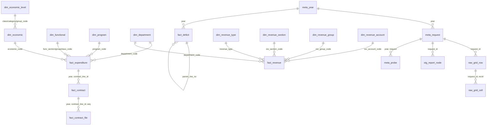

# DuckDB տվյալների բազա

[English](../en/database.md) | **Հայերեն** | [Русский](../ru/database.md)

Ֆայլ՝ `data/arm_budget.duckdb` (ստեղծվում է `make build` հրամանով. ամեն գործարկման ժամանակ ամբողջությամբ վերակառուցվում է `data/raw` և `data/catalog` թղթապանակներից): Սյուների ամբողջական ցանկը գտնվում է [data_dictionary.md](../data_dictionary.md) ֆայլում (գեներացվում է `COMMENT ON` նկարագրություններից, որոնք պահվում են նաև հենց տվյալների բազայում):

## Նախագծման սկզբունքներ

1. **Շերտեր։** Ծագում (`meta_*`) → դասակարգիչներ (`dim_*`) → փաստեր (`fact_*`) → յուրաքանչյուր հաշվետվության ծառի բոլոր տողերը
   (`stg_report_node`) → առանց կորստի ցանցային բջիջներ (`raw_*`) → տվյալների որակի ստուգումներ (`qc_*`) → դիտումներ (`v_*`)։
2. **Առավել մանրամասն մակարդակ։** Փաստերը կայքի թույլատրած ամենամանրամասն հարցման տերևներն են. ծախսերի համար՝
   գործառական դասակարգման դաս × ծրագիր × գերատեսչություն × տնտեսագիտական դասակարգման հոդված (տարեկան ≈3 600 տող), եկամուտների համար՝ եկամտի տեսակ ×
   բաժին × խումբ × գերատեսչություն × հաշիվ (տարեկան ≈450–480 տող, գումարած յուրաքանչյուր տարվա և տեսակի համար մեկ `unallocated` տող՝
   պլանի այն մասով, որը կայքը չի բաշխում հաշիվների միջև)։ Կայքի բոլոր ընդհանուր գումարները կարելի է վերարտադրել
   դրանք գումարելով. կայքի հրապարակած միջանկյալ գումարները գտնվում են `stg_report_node`-ում և ստուգվում են (`qc_tree_subtotal`)։
3. **Փաստերում՝ կոդեր, ոչ թե անվանումներ։** Փաստերը պարունակում են դասակարգիչների կոդեր (տողեր՝ սկզբի զրոներով. `'01'`,
   `'010101'`, `'004828'`, `'4111'`, `'900005160750'`)։ Անվանումները գտնվում են `dim_*` աղյուսակներում երեք լեզվով.
   `name_hy` (աղբյուր), `name_en`, `name_ru` (թարգմանություններ, տե՛ս [translations.md](translations.md))։ Կոդը պահում է
   այն վերջին տարվա անվանումը, որում հանդիպում է. բոլոր տարիների անվանումները գտնվում են `dim_name`-ում։
4. **Լայն՝ ըստ ժամանակաշրջանի։** Փաստի մեկ տողը պարունակում է աղբյուրի 8 գումարները. պլան և կատարում 1-ին եռամսյակի, կիսամյակի, 9 ամսվա և
   տարվա համար (`q1_plan_kamd` … `year_actual_kamd`), կուտակային՝ հունվարի 1-ից, **հազ. դրամով** (`_kamd`), ճշգրիտ
   `DECIMAL` արժեքներ՝ ինչպես հրապարակված են։ `v_*_long` դիտումներում յուրաքանչյուր ժամանակաշրջանին համապատասխանում է մեկ տող։
5. **Առանց կորստի։** Յուրաքանչյուր հաշվետվության ցանցի յուրաքանչյուր բջիջ գտնվում է `raw_grid_cell`-ում (տողերը՝ ինչպես աղբյուրում, ներառյալ `%`
   սյուները). փաստերը մատնանշում են իրենց աղբյուրի տողը (`request_id`, `recid`)։
6. **Վերարտադրելի։** Սխեմա՝ `sql/schema.sql`, դիտումներ՝ `sql/views.sql`, ստուգումներ՝ `sql/qc.sql`. կառուցումը ատոմային է
   և ցանց չի պահանջում (կոդերի վերծանումը օգտագործում է պահված ստուգիչ հարցումները)։

## Սխեմա



## Աղյուսակներ

### Մետատվյալներ

| աղյուսակ | մեկ տող = | բանալի |
|---|---|---|
| `meta_language` | անվանումների լեզու (hy՝ աղբյուր, en, ru) | `lang` |
| `meta_report` | կայքի հաշվետվություն (ծախսեր, եկամուտներ, դեֆիցիտ) | `report` |
| `meta_year` | կայքի բյուջետային տարի, նրա `SITE_YEAR` ինդեքսը և «դրությամբ» ամսաթիվը | `year` |
| `meta_site_total` | հաշվետվության ընդհանուր գումարը սկզբնական էջի մենյուում (վերջին տարի) | `report` |
| `meta_request` | հաշվետվության հարցում և դրա արդյունքի ֆայլ | `request_id` = `<name>@<year>` |
| `meta_probe` | ֆիլտրված հարցում, որն օգտագործվում է դասակարգիչների կոդերը վերծանելու համար | `year, request, dim, code` |
| `meta_document` | ձևից հղված PDF փաստաթուղթ | `file` |
| `meta_label` | կայքի ինտերֆեյսի մակագրություն / տարբերակ՝ թարգմանություններով | `context, key` |

### Դասակարգիչներ

| աղյուսակ | մեկ տող = | բանալի | մակարդակներ / նշումներ |
|---|---|---|---|
| `dim_functional` | գործառական դասակարգում (COFOG) | `code` | `level` 1՝ բաժին (2 թվանշան), 2՝ խումբ (4), 3՝ դաս (6); `parent_code` |
| `dim_program` | ծրագիր/միջոցառում | `code` (6 թվանշան) | |
| `dim_department` | պետական մարմին (վարչական դասակարգում) | `code` (6 թվանշան) | ընդհանուր է ծախսերի և եկամուտների համար |
| `dim_economic` | ծախսերի տնտեսագիտական դասակարգման հոդված | `code` (4 թվանշան) | `class_code`, `category_code`, `group_code` → `dim_economic_level` |
| `dim_economic_level` | տնտեսագիտական դասակարգման դաս / կատեգորիա / խումբ | `code` (1–3 թվանշան) | PDF մեթոդական ցուցումներից |
| `dim_revenue_type` | եկամտի տեսակ (`SITE_EBUDG`) | `revenue_type` | 0՝ բոլորը, 1՝ հարկեր և տուրքեր, 2՝ դրամաշնորհներ, 3՝ այլ |
| `dim_revenue_section` | եկամտի բաժին | `code` (2 թվանշան) | |
| `dim_revenue_group` | եկամտի խումբ | `code` (4 թվանշան) | չի սկսվում բաժնի կոդով |
| `dim_revenue_account` | եկամտի գանձապետական հաշիվ | `code` (12 թվանշան) | |
| `dim_period` | արժեքների սյուների ժամանակաշրջան | `period` | q1, h1, m9, year |
| `dim_name` | կոդի անվանումը տվյալ տարում | `report, dim, code, year` | անվանումները տարիների ընթացքում փոխվում են |
| `dim_translation` | թարգմանությունների բառարան hy → en / ru | `context, hy` | `data/translations/*.csv` |

Կոդեր ունեցող յուրաքանչյուր `dim_*` ունի `first_year` / `last_year`. այն տարիները, որոնցում կոդը հանդիպում է դասակարգիչների ցանկերում։
Ցանկերը պարունակում են նաև այն կոդերը, որոնք տվյալ տարում տվյալներ չունեն։

### Փաստեր

| աղյուսակ | մեկ տող = | բանալի |
|---|---|---|
| `fact_expenditure` | բյուջետային տող. դաս × ծրագիր × գերատեսչություն × հոդված՝ տարվա կտրվածքով | `year, line_no` |
| `fact_revenue` | եկամտի տող. տեսակ × բաժին × խումբ × գերատեսչություն × հաշիվ՝ տարվա կտրվածքով (`line_kind = 'line'`), կամ հաշիվների միջև չբաշխված տեսակի պլանը (`'unallocated'`) | `year, revenue_type, line_no` |
| `fact_deficit` | դեֆիցիտի ֆինանսավորման հաշվետվության տող | `year, line_no` |
| `fact_contract` | ծախսերի տողից վճարվող պայմանագիր | `year, contract_line_id, seq` |
| `fact_contract_file` | պայմանագրի փաստաթղթի հղում | `year, contract_line_id, seq, file_no` |

`fact_deficit.row_kind`՝ `total` (ԸՆԴԱՄԵՆԸ), `source` (A ներքին / B արտաքին), `item` (1., 2.), `subitem`
(1.1, 2.3.), `detail` (անհամարակալ մանրամասնում. մարմիններ, ընկերություններ, վարկեր), `note` (բաժանարար տողեր «այդ թվում» /
«որից», առանց արժեքների)։ Միայն համարակալված տողերն են կազմում գումարվող հիերարխիա (`item_code`՝ `A.1.1`). մանրամասնման տողերը
կարող են համընկնել։ `in_totals_view`-ն նշում է այն տողերը, որոնք կայքը ցույց է տալիս նաև իր «ընդհանուր» դիտման մեջ։

### Staging, raw, որակ

| աղյուսակ | պարունակություն |
|---|---|
| `stg_report_node` | ծախսերի և եկամուտների ծառերի բոլոր տողերը. ընդհանուր գումար (`level = -1`), միջանկյալ գումարներ, տերևներ՝ վերծանված կոդով և եղանակով (`name` / `probe`) |
| `raw_grid_row`, `raw_grid_cell` | յուրաքանչյուր հաշվետվության ցանցի բոլոր տողերը և ոչ դատարկ բջիջները՝ որպես տողեր |
| `qc_*`, `qc_summary` | տվյալների որակի ստուգումներ, տե՛ս [data_quality.md](data_quality.md) |

### Դիտումներ (view)

| դիտում | պարունակություն |
|---|---|
| `v_expenditure` | `fact_expenditure` բոլոր դասակարգիչների անվանումներով hy / en / ru լեզուներով և տնտեսագիտական դասակարգման վերին մակարդակներով, `year_execution_pct` |
| `v_expenditure_long` | ծախսեր՝ ժամանակաշրջանին մեկ տող (`plan_kamd`, `actual_kamd`) |
| `v_revenue`, `v_revenue_long` | նույնը՝ եկամուտների համար |
| `v_deficit` | դեֆիցիտի տողեր՝ առանց բաժանարար տողերի, թարգմանություններով |
| `v_contract` | պայմանագրեր՝ իրենց ծախսային տողի դասակարգմամբ |
| `v_summary` | ընդհանուր գումարներ ըստ տարիների. ծախսերի, եկամուտների, դեֆիցիտի պլաններ և կատարում. տողերի և պայմանագրերի քանակ |
| `v_expenditure_by_department`, `v_expenditure_by_function` | տարեկան պլան և կատարում ըստ գերատեսչության / գործառական բաժնի |

## Հարցումների օրինակներ

```sql
-- Totals by year, billion AMD
SELECT year, as_of_date,
       round(expenditure_plan_kamd / 1e6, 1) AS exp_plan_bn, round(expenditure_actual_kamd / 1e6, 1) AS exp_actual_bn,
       round(revenue_plan_kamd / 1e6, 1) AS rev_plan_bn, round(revenue_actual_kamd / 1e6, 1) AS rev_actual_bn
FROM v_summary ORDER BY year;

-- Expenditures by functional section (COFOG), 2025, in English
SELECT func_section_code, func_section_en, round(year_actual_kamd / 1e6, 1) AS actual_bn, year_execution_pct
FROM v_expenditure_by_function WHERE year = 2025 ORDER BY func_section_code;

-- Ten largest programs of the latest year, names in Russian
SELECT program_code, any_value(program_ru) AS program, round(sum(year_plan_kamd) / 1e6, 2) AS plan_bn
FROM v_expenditure WHERE year = (SELECT max(year) FROM meta_year)
GROUP BY program_code ORDER BY plan_bn DESC LIMIT 10;

-- Execution by economic category and quarter (cumulative), 2025
SELECT e.category_code, l.name_en, p.period, round(sum(f.actual_kamd) / 1e6, 1) AS actual_bn
FROM v_expenditure_long f JOIN dim_economic e ON e.code = f.economic_code
JOIN dim_economic_level l ON l.code = e.category_code JOIN dim_period p USING (period)
WHERE f.year = 2025 GROUP BY ALL ORDER BY e.category_code, any_value(p.sort);

-- Revenues by type and section, latest year
SELECT revenue_type_en, rev_section_en, round(sum(year_actual_kamd) / 1e6, 1) AS actual_bn
FROM v_revenue WHERE year = (SELECT max(year) FROM meta_year) GROUP BY ALL ORDER BY actual_bn DESC;

-- Largest counterparties by payments under contracts, 2025
SELECT partner_hy, any_value(partner_en) AS partner_en, count(*) AS contracts, round(sum(paid_kamd) / 1e3, 1) AS paid_mln_amd
FROM fact_contract WHERE year = 2025 GROUP BY partner_hy ORDER BY paid_mln_amd DESC LIMIT 15;

-- Deficit financing: numbered lines only
SELECT item_code, label_en, year_plan_kamd, year_actual_kamd
FROM v_deficit WHERE year = 2025 AND item_code IS NOT NULL ORDER BY line_no;

-- Subtotals exactly as published by the site (e.g. departments within program 004828)
SELECT n.label_hy, n.code, n.year_plan_kamd FROM stg_report_node n
WHERE n.request_id = 'expenditure@2026' AND n.dim = 'department'
  AND n.parent_recid IN (SELECT recid FROM stg_report_node WHERE request_id = 'expenditure@2026' AND code = '004828');
```

## Վերապահումներ

* Վերջին տարին թերի է. `year_actual_kamd`-ը կատարումն է մինչև `meta_year.as_of_date`։
* Եկամուտների պլանները հիմնականում սահմանվում են եկամտի տեսակի որպես ամբողջության համար (տող `line_kind = 'unallocated'`, հարկերի պլանի ≈97 %)՝
  եկամուտների պլանը և կատարումը համեմատեք տեսակի մակարդակով. հաշվի մակարդակի պլանները մասնակի են։
* Դեֆիցիտի տողերը գումարվող չեն, բացի համարակալվածներից (`item_code IS NOT NULL`)։
* Պայմանագրերի վճարումները տրվում են ըստ տողերի. մի քանի տողից վճարվող պայմանագիրը հանդիպում է մի քանի անգամ՝ ամեն անգամ
  պայմանագրի ամբողջ գումարով. մի՛ գումարեք `amount_kamd`-ը միևնույն պայմանագրի տարբեր տողերով։
* Անգլերեն և ռուսերեն անվանումները մեքենայական օգնությամբ կատարված թարգմանություններ են. հայերեն անվանումը հիմնարար է։
* Կայքը պահում է ընդամենը երեք տարի. ավելի հին կտրվածքները կան միայն այս պահոցի թողարկումներում։
