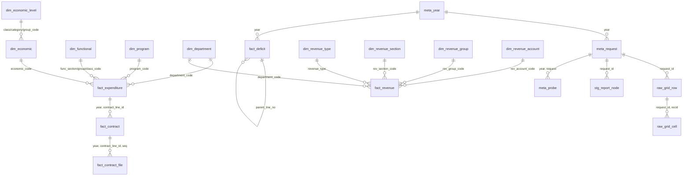

# База данных DuckDB

[English](../en/database.md) | [Հայերեն](../hy/database.md) | **Русский**

Файл: `data/arm_budget.duckdb` (собирается командой `make build`; при каждом запуске создается заново из `data/raw` и
`data/catalog`). Полный список столбцов приведен в [data_dictionary.md](../data_dictionary.md) (генерируется из
описаний `COMMENT ON`, которые также хранятся в самой базе данных).

## Принципы устройства

1. **Слои.** Происхождение данных (`meta_*`) → классификаторы (`dim_*`) → факты (`fact_*`) → каждая строка каждого дерева отчета
   (`stg_report_node`) → ячейки таблиц без потерь (`raw_*`) → проверки качества данных (`qc_*`) → представления (`v_*`).
2. **Наиболее детальная гранулярность.** Факты — это листья самого подробного запроса, который допускает сайт: для расходов
   функциональный класс × программа × ведомство × статья экономической классификации (≈3 600 строк в год), для доходов вид доходов ×
   раздел × группа × ведомство × счет (≈450–480 строк в год, плюс одна строка `unallocated` на год и вид с
   частью плана, которую сайт не распределяет по счетам). Суммированием можно воспроизвести все итоги сайта;
   промежуточные итоги, опубликованные сайтом, находятся в `stg_report_node` и проверяются (`qc_tree_subtotal`).
3. **В фактах коды, а не названия.** Факты содержат коды классификаторов (строки с ведущими нулями: `'01'`,
   `'010101'`, `'004828'`, `'4111'`, `'900005160750'`). Названия хранятся в таблицах `dim_*` на трех языках:
   `name_hy` (источник), `name_en`, `name_ru` (переводы, см. [translations.md](translations.md)). За кодом закрепляется
   название последнего года, в котором он встречается; все названия по годам хранятся в `dim_name`.
4. **Широкая таблица по периодам.** Одна строка фактов содержит 8 сумм источника: план и исполнено за 1 квартал, полугодие, 9 месяцев и
   год (`q1_plan_kamd` … `year_actual_kamd`), нарастающим итогом с 1 января, в **тыс. драмов** (`_kamd`), точные
   значения `DECIMAL`, как они опубликованы. В представлениях `v_*_long` одна строка соответствует одному периоду.
5. **Без потерь.** Каждая ячейка каждой таблицы отчета хранится в `raw_grid_cell` (строки как в источнике, включая столбцы
   `%`); факты ссылаются на свою исходную строку (`request_id`, `recid`).
6. **Воспроизводимость.** Схема — `sql/schema.sql`, представления — `sql/views.sql`, проверки — `sql/qc.sql`; сборка атомарна
   и не требует сети (определение кодов использует сохраненные пробные запросы).

## Схема



## Таблицы

### Метаданные

| таблица | одна строка = | ключ |
|---|---|---|
| `meta_language` | язык названий (hy — источник, en, ru) | `lang` |
| `meta_report` | отчет сайта (расходы, доходы, дефицит) | `report` |
| `meta_year` | бюджетный год на сайте, его индекс `SITE_YEAR` и дата «по состоянию на» | `year` |
| `meta_site_total` | итог отчета в меню стартовой страницы (последний год) | `report` |
| `meta_request` | запрос отчета и файл с его результатом | `request_id` = `<name>@<year>` |
| `meta_probe` | фильтрованный запрос, используемый для определения кодов классификаторов | `year, request, dim, code` |
| `meta_document` | PDF-документ, на который ссылается форма | `file` |
| `meta_label` | подпись / вариант выбора интерфейса сайта с переводами | `context, key` |

### Классификаторы

| таблица | одна строка = | ключ | уровни / примечания |
|---|---|---|---|
| `dim_functional` | функциональная классификация (COFOG) | `code` | `level` 1 раздел (2 цифры), 2 группа (4), 3 класс (6); `parent_code` |
| `dim_program` | программа/мероприятие | `code` (6 цифр) | |
| `dim_department` | государственный орган (административная классификация) | `code` (6 цифр) | общий для расходов и доходов |
| `dim_economic` | статья экономической классификации расходов | `code` (4 цифры) | `class_code`, `category_code`, `group_code` → `dim_economic_level` |
| `dim_economic_level` | класс / категория / группа экономической классификации | `code` (1–3 цифры) | из методических указаний в PDF |
| `dim_revenue_type` | вид доходов (`SITE_EBUDG`) | `revenue_type` | 0 все, 1 налоги и пошлины, 2 гранты, 3 прочие |
| `dim_revenue_section` | раздел доходов | `code` (2 цифры) | |
| `dim_revenue_group` | группа доходов | `code` (4 цифры) | не начинается с кода раздела |
| `dim_revenue_account` | казначейский счет доходов | `code` (12 цифр) | |
| `dim_period` | период столбцов значений | `period` | q1, h1, m9, year |
| `dim_name` | название кода в году | `report, dim, code, year` | названия меняются от года к году |
| `dim_translation` | словарь переводов hy → en / ru | `context, hy` | `data/translations/*.csv` |

Каждая таблица `dim_*` с кодами имеет `first_year` / `last_year`: годы, в которых код встречается в списках классификатора.
Списки содержат также коды, по которым в данном году нет данных.

### Факты

| таблица | одна строка = | ключ |
|---|---|---|
| `fact_expenditure` | бюджетная строка: класс × программа × ведомство × статья за год | `year, line_no` |
| `fact_revenue` | строка доходов: вид × раздел × группа × ведомство × счет за год (`line_kind = 'line'`) или план вида, не распределенный по счетам (`'unallocated'`) | `year, revenue_type, line_no` |
| `fact_deficit` | строка отчета о финансировании дефицита | `year, line_no` |
| `fact_contract` | договор, оплачиваемый по строке расходов | `year, contract_line_id, seq` |
| `fact_contract_file` | ссылка на документ договора | `year, contract_line_id, seq, file_no` |

`fact_deficit.row_kind`: `total` (ԸՆԴԱՄԵՆԸ), `source` (A внутренние / B внешние), `item` (1., 2.), `subitem`
(1.1, 2.3.), `detail` (ненумерованная детализация: органы, компании, займы), `note` (разделительные строки "в том числе" «այդ թվում» /
«որից», без значений). Аддитивную иерархию образуют только нумерованные строки (`item_code`: `A.1.1`); строки детализации могут
пересекаться. `in_totals_view` отмечает строки, которые сайт показывает также в представлении «итоги».

### Промежуточные данные, сырые данные, качество

| таблица | содержимое |
|---|---|
| `stg_report_node` | каждая строка деревьев расходов и доходов: общий итог (`level = -1`), промежуточные итоги, листья, с определенным кодом и методом (`name` / `probe`) |
| `raw_grid_row`, `raw_grid_cell` | каждая строка и непустая ячейка каждой таблицы отчета, в виде строк |
| `qc_*`, `qc_summary` | проверки качества данных, см. [data_quality.md](data_quality.md) |

### Представления

| представление | содержимое |
|---|---|
| `v_expenditure` | `fact_expenditure` с названиями всех классификаторов на hy / en / ru и верхними уровнями экономической классификации, `year_execution_pct` |
| `v_expenditure_long` | расходы с одной строкой на период (`plan_kamd`, `actual_kamd`) |
| `v_revenue`, `v_revenue_long` | то же для доходов |
| `v_deficit` | строки дефицита без разделительных строк, с переводами |
| `v_contract` | договоры с классификацией их строки расходов |
| `v_summary` | итоги по годам: планы и исполнение расходов, доходов, дефицита; количество строк и договоров |
| `v_expenditure_by_department`, `v_expenditure_by_function` | годовой план и исполнение по ведомствам / функциональным разделам |

## Примеры запросов

```sql
-- Totals by year, billion AMD
SELECT year, as_of_date,
       round(expenditure_plan_kamd / 1e6, 1) AS exp_plan_bn, round(expenditure_actual_kamd / 1e6, 1) AS exp_actual_bn,
       round(revenue_plan_kamd / 1e6, 1) AS rev_plan_bn, round(revenue_actual_kamd / 1e6, 1) AS rev_actual_bn
FROM v_summary ORDER BY year;

-- Expenditures by functional section (COFOG), 2025, in English
SELECT func_section_code, func_section_en, round(year_actual_kamd / 1e6, 1) AS actual_bn, year_execution_pct
FROM v_expenditure_by_function WHERE year = 2025 ORDER BY func_section_code;

-- Ten largest programs of the latest year, names in Russian
SELECT program_code, any_value(program_ru) AS program, round(sum(year_plan_kamd) / 1e6, 2) AS plan_bn
FROM v_expenditure WHERE year = (SELECT max(year) FROM meta_year)
GROUP BY program_code ORDER BY plan_bn DESC LIMIT 10;

-- Execution by economic category and quarter (cumulative), 2025
SELECT e.category_code, l.name_en, p.period, round(sum(f.actual_kamd) / 1e6, 1) AS actual_bn
FROM v_expenditure_long f JOIN dim_economic e ON e.code = f.economic_code
JOIN dim_economic_level l ON l.code = e.category_code JOIN dim_period p USING (period)
WHERE f.year = 2025 GROUP BY ALL ORDER BY e.category_code, any_value(p.sort);

-- Revenues by type and section, latest year
SELECT revenue_type_en, rev_section_en, round(sum(year_actual_kamd) / 1e6, 1) AS actual_bn
FROM v_revenue WHERE year = (SELECT max(year) FROM meta_year) GROUP BY ALL ORDER BY actual_bn DESC;

-- Largest counterparties by payments under contracts, 2025
SELECT partner_hy, any_value(partner_en) AS partner_en, count(*) AS contracts, round(sum(paid_kamd) / 1e3, 1) AS paid_mln_amd
FROM fact_contract WHERE year = 2025 GROUP BY partner_hy ORDER BY paid_mln_amd DESC LIMIT 15;

-- Deficit financing: numbered lines only
SELECT item_code, label_en, year_plan_kamd, year_actual_kamd
FROM v_deficit WHERE year = 2025 AND item_code IS NOT NULL ORDER BY line_no;

-- Subtotals exactly as published by the site (e.g. departments within program 004828)
SELECT n.label_hy, n.code, n.year_plan_kamd FROM stg_report_node n
WHERE n.request_id = 'expenditure@2026' AND n.dim = 'department'
  AND n.parent_recid IN (SELECT recid FROM stg_report_node WHERE request_id = 'expenditure@2026' AND code = '004828');
```

## Особенности и ограничения

* Последний год неполон: `year_actual_kamd` — это исполнение до `meta_year.as_of_date`.
* Планы доходов устанавливаются в основном по виду доходов в целом (строка `line_kind = 'unallocated'`, ≈97 % плана
  налогов): сравнивайте план и исполнение доходов на уровне вида; планы на уровне счетов неполны.
* Строки дефицита не аддитивны, за исключением нумерованных (`item_code IS NOT NULL`).
* Платежи по договорам привязаны к строкам: договор, оплачиваемый по нескольким строкам, встречается несколько раз, каждый раз с полной
  суммой договора — не суммируйте `amount_kamd` по строкам одного договора.
* Названия на английском и русском языках получены с помощью машинного перевода; авторитетным является название на армянском.
* Сайт хранит только три года: более старые срезы есть только в релизах этого репозитория.
